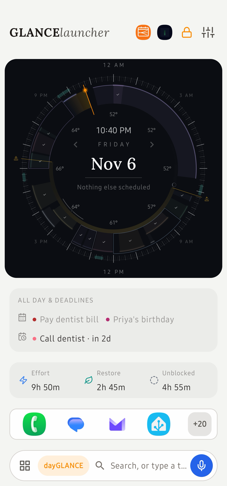
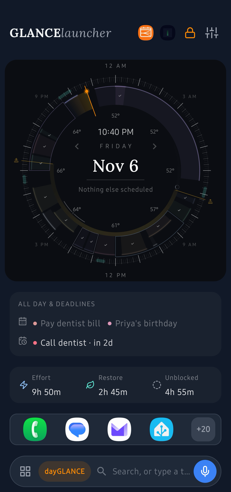
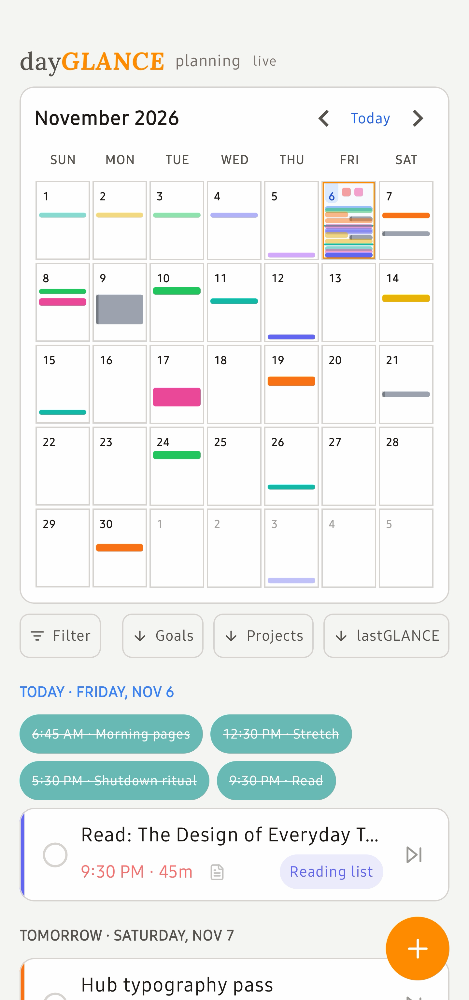
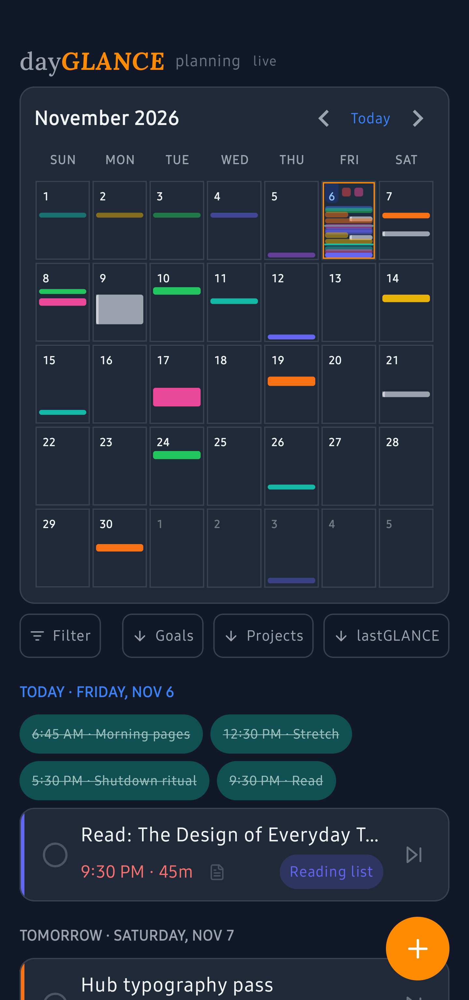
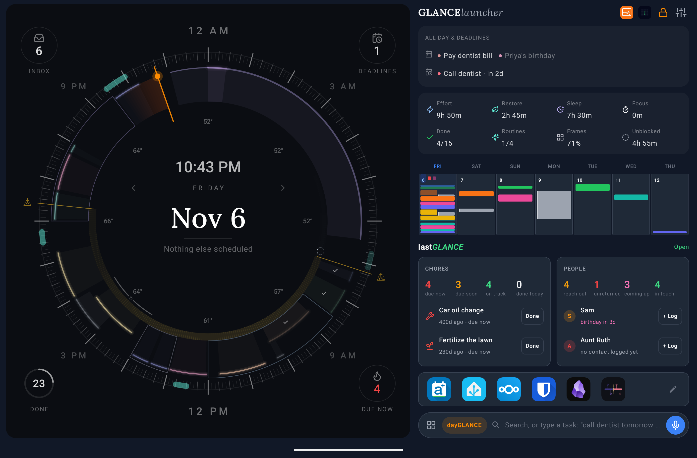

# GLANCElauncher

A home screen for Android built around [dayGLANCE](https://github.com/krelltunez/dayGLANCE) and
[lastGLANCE](https://github.com/krelltunez/lastGLANCE). Your day's schedule is the first thing
you see on every unlock, drawn as dayGLANCE's Day Dial, with quick capture from the search bar
and your plans one swipe away.

It also works on its own. The app drawer, search, pinned apps and the taskbar need neither app.
Where dayGLANCE or lastGLANCE is not installed (or is too old to trust the launcher), the
launcher shows a built-in set of demo data for that app instead, marks it as demo, and offers a
link to install it. Changes you make to demo data are not saved.

Native Kotlin and Jetpack Compose. Made for tablets in landscape and portrait, and for phones in
portrait.

## Screenshots

<!-- Screenshots to be added: the files below do not exist yet. -->

| Home, light | Home, dark |
|---|---|
|  |  |

| Planning, light | Planning, dark |
|---|---|
|  |  |

## Features

- **The Day Dial on Home.** A port of dayGLANCE's in-app dial: today's blocks around a 24-hour
  ring, routines, frames, imported calendar events, sunrise and sunset, the moon, the weather and
  your next alarm. Tap a block to see it, tap again to complete it, start focus or open it in
  dayGLANCE. Drag a block to move it, drag its end to resize it, and long-press an empty part
  of the ring to create one. A lock in the header turns the gestures off.
- **The rest of Home.** All-day items and upcoming deadlines, the day's breakdown, a week strip,
  lastGLANCE's chores and people with Done and Log buttons, a row of pinned apps and the search
  bar. On a tablet the dial's corners show the Inbox count, deadlines, the share done and
  lastGLANCE's due chores. Nothing on Home scrolls.
- **Planning, one swipe away.** A month grid and the agenda from dayGLANCE's SCHED view, goals and
  projects with their progress, lastGLANCE's pinned and due chores, upcoming birthdays and
  anniversaries, and people to reach out to. Taps open the matching screen in the app.
- **Search and quick capture.** One search for apps, app shortcuts, Settings pages, contacts (if
  you allow it), your dayGLANCE tasks, projects and goals, and your lastGLANCE chores and people.
  It also does sums and ends with a web search. Typing a task in dayGLANCE's quick-add grammar
  ("dentist friday 3pm 30m") adds it to dayGLANCE; start with `lg ` to add or log in lastGLANCE.
- **Voice search.** The mic types what you say into search, recognised on the device. Simple
  commands ("open Spotify", "set a timer for 10 minutes", "remind me to call the plumber
  tomorrow") run on their own when nothing is in doubt. A long press opens dayGLANCE's own
  voice capture.
- **App drawer.** Alphabetical and searchable, with apps you opened recently at the top. Hide apps,
  pin them to Home or the taskbar, and reach an app's shortcuts from a long press. Swipe up on Home
  to open it and down to close it.
- **Taskbar.** Optional, under both pages: pinned apps on the left, recent ones on the right. Drag
  an icon upward to open it in split screen.
- **Small things a home screen should do.** Notification dots, themed icons (Android 13 and
  later), double-tap to lock, pull down for the notification shade, "Add to Home screen" from
  other apps, and light and dark themes that follow dayGLANCE's palette.
- **Settings backup.** Export the launcher's settings to a file and import them on another device
  or after a reinstall.
- **Diagnostics.** Long-press either app's icon in Home's header to see how fresh its data is and
  when each app last refreshed.

## Requirements

- **Android 12 or newer** (minSdk 31).
- **dayGLANCE and lastGLANCE are optional.** Without them, or with versions too old to trust the
  launcher, it shows demo data for that app. For live data, install recent versions of the
  apps.

## Install

- **Google Play:** [GLANCElauncher on Google Play](https://play.google.com/store/apps/details?id=app.glance.launcher).
- **APK:** the signed APK is attached to the
  [dayGLANCE releases](https://github.com/krelltunez/dayGLANCE/releases) and the
  [lastGLANCE releases](https://github.com/krelltunez/lastGLANCE/releases) on GitHub. Download it,
  open it, and allow installs from that source if Android asks.
- **From source:** see [docs/building.md](docs/building.md). A build you sign yourself shows demo
  data, because the apps trust only the release key.

Then open GLANCElauncher and go to Settings → **Set as Home app**. To go back, choose another
home app in Android's Settings → Apps → Default apps → Home app.

## Permissions

GLANCElauncher has no INTERNET permission, so nothing it reads leaves the phone. The optional
permissions are asked for only when you turn on the setting that needs them, and the launcher
works without any of them.

| Permission | What it is for |
|---|---|
| `QUERY_ALL_PACKAGES` | Lists your installed apps so it can show, search, pin and launch them. Required for a home screen. |
| `PACKAGE_USAGE_STATS` (optional) | Usage access, granted in Android's settings from the link under Settings → Taskbar. Lets the taskbar's recent apps include apps you opened elsewhere, such as from a notification. It reads only which apps were used in the last two days. Without it, recents come from the launcher's own launch history. |
| Notification listener (optional) | Notification access, granted from the link under Settings → Notification dots. Used only to draw the dots: it reads which app posted a notification and whether it has text to show, never what it says, and keeps nothing. |
| `READ_CONTACTS` (optional) | Settings → Contacts in search. Lets search find your contacts by name. It reads names, plus a number when you call or text someone from search. |
| `RECORD_AUDIO` (optional) | Voice search from the mic in the search bar, asked for on the first tap. Speech is recognised on the device, or by Android's recognizer asked to stay offline. |
| Accessibility service (optional) | Settings → Double-tap to lock. The service performs one action, locking the screen, so fingerprint and face unlock keep working. It receives no events and cannot read the screen. |
| `com.dayglance.permission.LAUNCHER`, `com.lastglance.permission.LAUNCHER` | Read each app's snapshot of your data and send it the changes you make in the launcher. Each app grants its permission only to launchers signed with a key it trusts, so no other app can use it. |
| `SET_WALLPAPER` | Settings → Solid wallpaper, off by default. Keeps the home-screen wallpaper a solid colour matching the theme, so another image never flashes during Android's transitions. Granted without a prompt. |
| `EXPAND_STATUS_BAR` | Pull down on Home to open the notification shade. Granted without a prompt. |
| `REQUEST_DELETE_PACKAGES` | The drawer's Uninstall, which hands over to Android's own uninstall confirmation. Granted without a prompt. |
| `SET_ALARM` | Tapping the dial's clock opens your clock app's alarms. Granted without a prompt. |

On Android 13 and later, an app installed from a downloaded APK cannot be given notification
access or an accessibility service until you allow it in App info. Settings explains the steps
under each link. A Google Play install does not need this.

Privacy policy: https://glance-apps.com/glancelauncher/privacy

## Limitations

- **Solid wallpaper cannot be undone.** It is off by default. Once you turn it on, the launcher
  cannot put your previous wallpaper back if you turn it off again, because reading it needs
  storage permissions the launcher does not ask for. Set your wallpaper again in Android's
  settings.
- **Data is as fresh as each app's last sync.** The launcher asks the apps to refresh when you
  return to Home, and they refresh in the background when closed, but Android can delay those
  runs (standby buckets, Doze). The diagnostics panel shows when each app last confirmed its data.
  Background refresh has not yet been measured after a reboot, in the rare standby bucket, under
  forced Doze, or when you open the app during a refresh.
- **Dial gestures:** blocks resize from their end edge only and cannot be dragged across midnight
  into another day, and routines cannot be dragged.
- **The dial leaves out** dayGLANCE's habit complication and its keyboard navigation (the ring
  has a content description only), and draws the glow with soft strokes rather than a blur.
  Without a location set in dayGLANCE there is no moon or weather, and the daylight band is an
  approximation.
- **Phones stay in portrait;** phone landscape is locked out rather than designed.
- **The taskbar does not stay on top** of other apps.
- **With usage access,** apps opened elsewhere join the taskbar's recents within 15 seconds rather
  than at once; apps opened from the launcher show immediately.
- **Planning's agenda** does not have SCHED's filter presets, "next instance only" or the
  routine pill's long-press time picker. A deadline's calendar button schedules at 09:00 (today,
  the next quarter hour) where the app opens a time picker.
- **No widgets.** The dial takes the space a widget area would.
- **App shortcuts** in search and the drawer, and "Add to Home screen", work only while
  GLANCElauncher is the default home app, as Android allows only that app to read them.

## Documentation

- [docs/spec.md](docs/spec.md): the launcher as built, and how it reads and writes the apps' data.
- [docs/decisions.md](docs/decisions.md): the numbered decision log behind it.
- [docs/building.md](docs/building.md): building, installing and testing from source.

## Licence

GLANCElauncher is released under the [MIT License](LICENSE). The APK also carries the Lora font
(SIL Open Font License), Lucide icons (ISC) and Apache-2.0 libraries (AndroidX, Jetpack Compose,
Kotlin); their licences are in [licenses/](licenses/) and in the launcher's Settings → Open source
licences.
